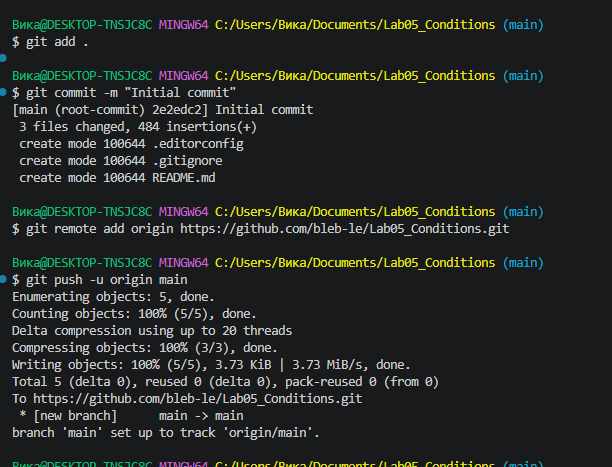
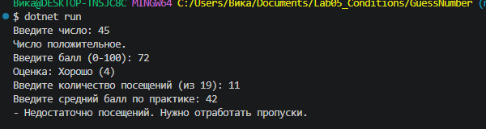
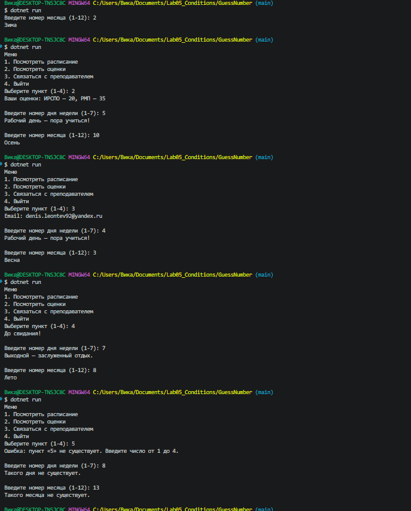
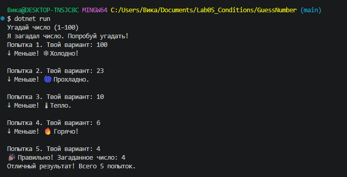

# Лабораторная работа №5. Условные операторы и множественный выбор

**ФИО:** беляева виктория дмитриевна
**Группа:** ИСП-241
**Дата:** 23.11.2026

## Краткое описание работы

в работе я изучила условные конструкции C#: `if/else`, `else if`, `switch/case`! я выполнила 5 самостоятельных заданий!!

## Структура проекта

```text
Lab05_Conditions/
├── .editorconfig
├── .gitignore
├── README.md
├── GuessNumber/
│   ├── GuessNumber.csproj
│   └── Program.cs
└── img/
    ├── gitPushLab05_belyaeva.png
    ├── step4_ifelseLab05_belyaeva.png
    ├── step6_switchLab05_belyaeva.png
    └── step7_guessGameLab05_belyaeva.png
```

## Пример кода: функция GetHint()

```csharp
string GetHint(int difference) {
    switch (difference) {
        case <= 3:
            return "🔥 Горячо!";
        case <= 10:
            return "🌡 Тепло.";
        case <= 25:
            return "🌀 Прохладно.";
        default:
            return "❄ Холодно!";
    }
}
```

## Скриншоты






## Главные выводы

1. если вариантов два-три, удобно писать `if/else`, п когда нужно сравнить одно число или слово сразу с кучей значений, лучше `switch`, он выглядит круче!
2. тернарный оператор `? :` сокращает код до одной строки, если условий много, проще написать `if`
3. с `int.TryParse()` программа не вылетает, если вместо числа ввели буквы
4. значки `&&`, `||` и `!` помогают объединять несколько условий в одно

## Итоговая таблица

| Конструкция | Когда использовать |
|:------------|:-------------------|
| `if/else` | Общее ветвление, сложные условия |
| `else if` | Несколько взаимоисключающих вариантов |
| `switch/case` | Сравнение одной переменной с конкретными значениями |
| Тернарный оператор `? :` | Выбор одного из двух значений в одну строку |
| `&&` | Оба условия должны быть истинны |
| `\|\|` | Хотя бы одно условие должно быть истинно |
| `!` | Отрицание условия |
| `int.TryParse()` | Безопасное преобразование строки в число |
| `Random.Next(min, max)` | Генерация случайного числа в диапазоне |

## Ответы на вопросы

**1. Чем `int.TryParse()` безопаснее `int.Parse()`? В каких случаях стоит использовать каждый?**

`int.Parse()` при неверном вводе (например, `abc`) выбрасывает исключение, и программа аварийно завершается. `int.TryParse()` возвращает `false` и не падает, поэтому программа может вывести сообщение и попросить ввести число заново. `TryParse` лучше для ввода пользователя. `Parse` подходит, когда формат гарантированно верный, а ошибка должна остановить программу.

**2. Когда `switch` удобнее, чем цепочка `if/else if`? Приведите пример из реальной жизни.**

Когда одну переменную сравнивают с несколькими конкретными значениями. Пример: кнопки в лифте или торговом автомате, каждому номеру соответствует своё действие

**3. Что произойдёт в `switch`, если убрать `break` после одного из `case`?**

В C# это приведёт к ошибке компиляции, C# не позволяет «проваливаться» в следующий `case`, если текущий `case` не пустой. «Проваливание» разрешено только для пустых `case`, идущих подряд, как в задаче с сезонами, где `case 12: case 1: case 2:` выполняют одно действие

**4. Чем отличается `=` от `==` в C#? Почему это частая ошибка?**

`=` присваивает значение переменной, а `==` сравнивает два значения и возвращает `true` или `false`. Знаки легко перепутать, потому что они выглядят похоже. В C# `if (x = 5)` для `int` не скомпилируется, так как присваивание не даёт `bool`. Но с переменной типа `bool` такая ошибка может пройти незамеченной.

**5. Можно ли написать тернарный оператор внутри другого тернарного оператора? Приведите пример из кода лабораторной и оцените читаемость такого кода.**

Можно! Пример из лабораторной:

```csharp
string weather = temp >= 20 ? "тепло" : (temp >= 0 ? "прохладно" : "мороз");
```

С одним уровнем вложенности код ещё читается, особенно со скобками. Если вложенность больше, читать его трудно, и лучше заменить на `if/else if`.